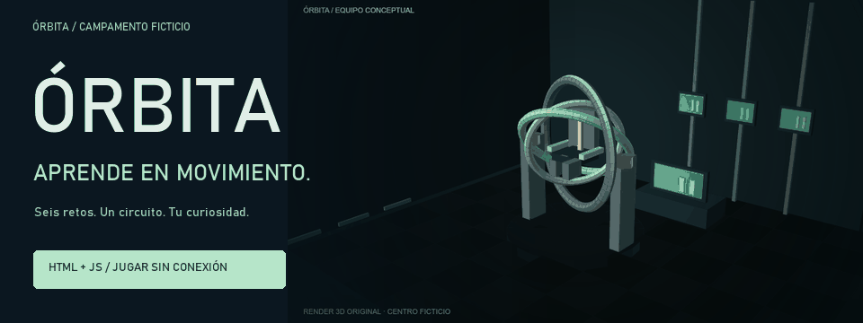
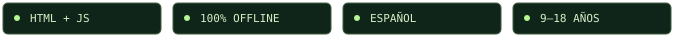
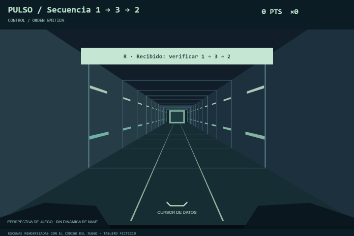
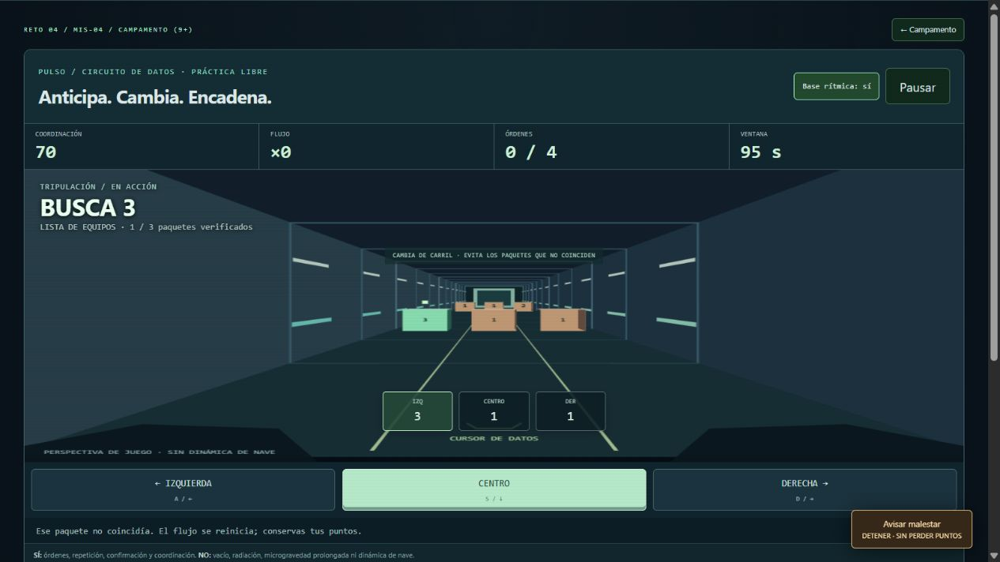
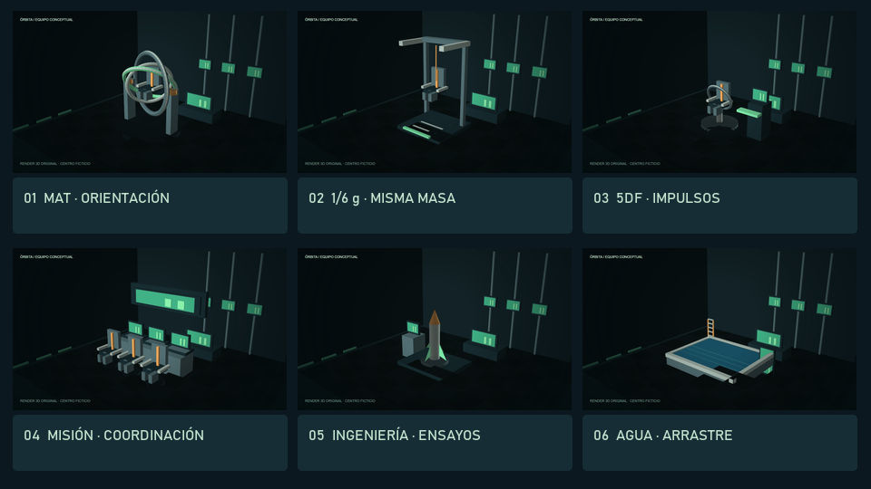
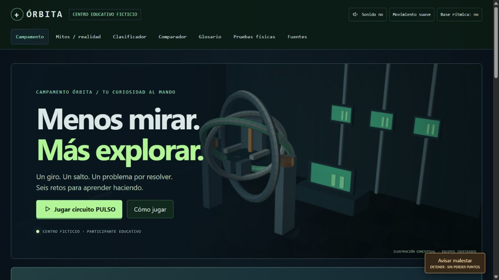
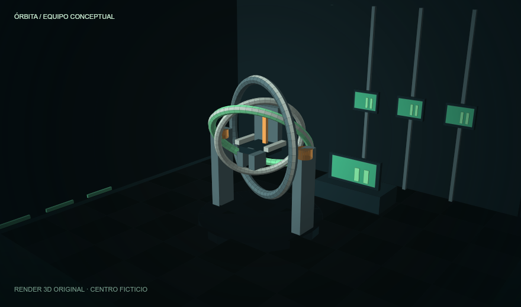
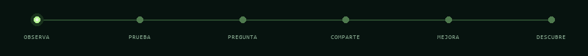

<p align="center">
  
</p>

<p align="center">
  
</p>

<p align="center">
  <a href="https://github.com/alejondr3/definitivo/raw/refs/heads/main/index.html"></a>
</p>

<p align="center">
  <a href="#el-juego-en-acción">Ver la demo</a> &nbsp; / &nbsp;
  <a href="#tu-ruta-de-seis-días">Explorar los retos</a> &nbsp; / &nbsp;
  <a href="docs/GUIA.md">Leer la guía</a>
</p>

<p align="center"><strong>Tu curiosidad tiene los controles.</strong><br>Salta con un arnés. Contrarresta un impulso. Entra al circuito PULSO.<br>Cierra cada reto con una idea nueva en tu bitácora.</p>

## El juego en acción

<p align="center"></p>

<p align="center"><sub>Escenas renderizadas con el código del juego. Modelos educativos idealizados.</sub></p>

### Nuevo: sesión PULSO

Avanza por un circuito de datos en perspectiva. Repite y confirma las órdenes sobre la escena, cambia de carril y recoge el paquete solicitado. Encadena aciertos mientras el escenario continúa avanzando. En **Práctica rápida** puedes entrar directamente, sin alterar los días completados.

Activa **Base rítmica** para escuchar percusión y bajo originales sintetizados en el navegador. El audio es opcional y se detiene al pausar o avisar malestar. La respiración y la física de los aparatos mantienen sus reglas.

<details><summary><strong>Ver el circuito PULSO</strong></summary>



</details>

## Tu ruta de seis días

<p align="center"></p>

**Juega a tu ritmo.** Elige Campamento, Academia o Academia Avanzada. Sigue las pistas, colecciona seis insignias educativas y vuelve a intentar las veces que quieras. El sonido es opcional y el movimiento se puede reducir.

## Del archivo a la aventura

1. **Descarga** [index.html](https://github.com/alejondr3/definitivo/raw/refs/heads/main/index.html).
2. **Ábrelo** con doble clic. No tienes que instalar nada para jugar.
3. **Entra al primer reto.** La guía te acompaña desde el comienzo.

En teléfono, abre el archivo con un navegador que admita HTML local. El juego no necesita conexión; los enlaces de Fuentes sí. Tu progreso queda solo en tu navegador cuando permite guardarlo.

<details>
<summary><strong>Una mirada al campamento y a los controles</strong></summary>





[Ver controles y ayuda completa →](docs/GUIA.md#controles-que-se-aprenden-jugando)

</details>

<details>
<summary><strong>Cómo se comprueba la física</strong></summary>

Las 11 verificaciones integradas y los 10 casos externos comprueban el modelo educativo: masa constante, peso aparente 1/6, descarga 5/6, impulso y vertical bloqueada. Además, hay dos pruebas de control del sintetizador y 22 grupos de pruebas de interacción.

```sh
node --test tests/physics.test.cjs tests/audio.test.cjs
```

Para las pruebas de interacción:

```sh
npm ci
npm run test:interaction
```

Estas comprobaciones verifican el software, no un aparato real ni la aptitud de una persona. [Detalles técnicos y límites →](docs/GUIA.md#la-ciencia-se-comprueba)

</details>

<details>
<summary><strong>El campamento es ficticio. La ciencia tiene límites.</strong></summary>

Eres un participante educativo. El diploma final es una graduación del campamento, no una certificación de vuelo. Cada estación distingue qué representa y qué deja fuera: vacío, radiación, microgravedad prolongada y dinámica completa de una nave no se reproducen.

El contenido sigue el informe proporcionado, con fecha de corte 7 de noviembre de 2026. Las 20 referencias están en Fuentes, dentro del juego. Los equipos son renders propios de geometría 3D, con materiales e iluminación calculados en código. El circuito se dibuja en perspectiva durante el juego; no se usaron generadores de imagen.

En el caso real, Space Camp lo opera el U.S. Space and Rocket Center en Huntsville, centro oficial de visitantes de NASA Marshall, pero **no parte de la NASA**. Órbita no representa a esas entidades.

**Avisar malestar** siempre está disponible y no resta puntos. Puedes completar las actividades como observador. [Seguridad, fuentes y alcance →](docs/GUIA.md#ciencia-con-límites-claros)

</details>

<br>

<p align="center"><strong>No necesitas saber la respuesta antes de empezar.</strong><br><sub>Solo necesitas ganas de probar.</sub></p>

<p align="center"></p>
