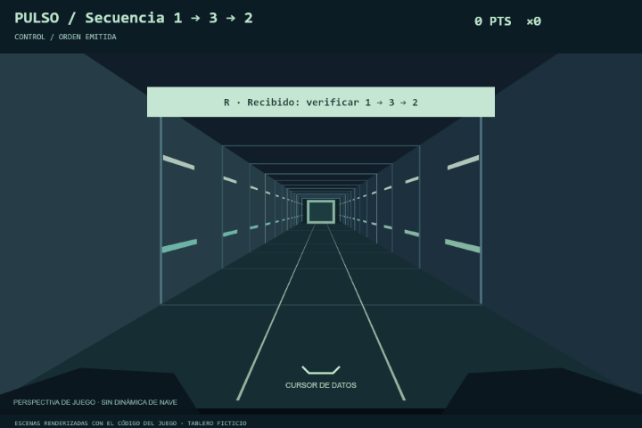
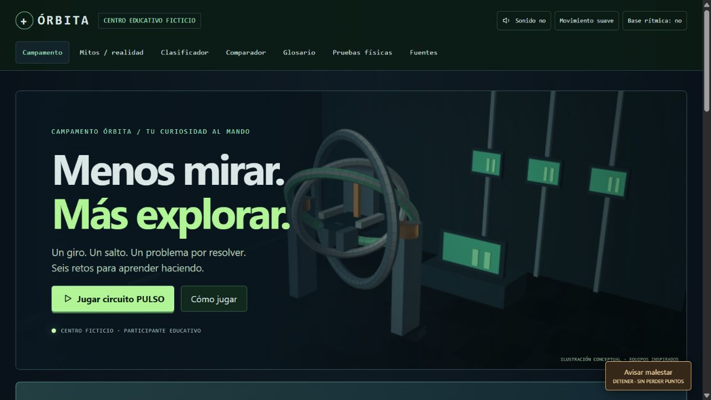
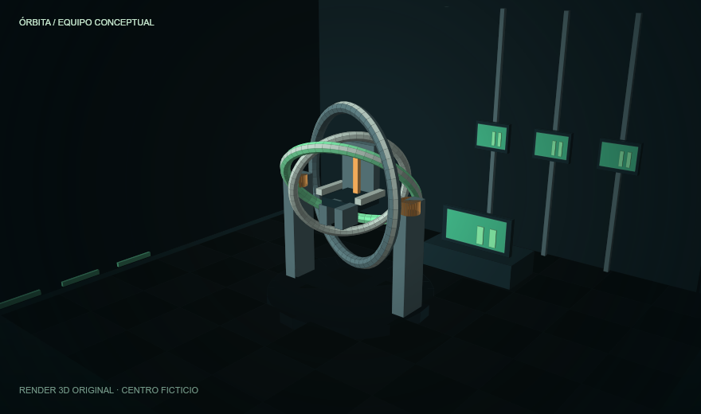

# Guía de Órbita

[Volver a la portada](../README.md)

## Juega en tu navegador

**Descarga [index.html](https://github.com/alejondr3/definitivo/raw/refs/heads/main/index.html), ábrelo con doble clic y entra al campamento.**

Sin instalar paquetes. Sin cuenta. Sin servidor. Sin conexión para jugar. Todas las ilustraciones, estilos y funciones del juego están dentro de ese único archivo. En teléfono, abre el archivo con un navegador que permita HTML local. Los enlaces de la bibliografía sí necesitan internet.

La primera vez aparece una guía breve. Antes de cada reto puedes practicar una decisión; durante la actividad, una pista indica tu siguiente paso. No hace falta saber de naves para empezar.

> **Tu misión es aprender.** Órbita es un centro ficticio. Participas en un campamento educativo; el diploma final no es una certificación de vuelo.

## Míralo en movimiento

<p align="center"></p>

El GIF se renderizó con las mismas funciones canvas del juego. Muestra modelos educativos idealizados, no prestaciones de aparatos reales.

<details><summary><strong>Ver capturas del campamento y del primer reto</strong></summary>





</details>

## Seis retos, una bitácora

| Día | Entra en acción | Descubre |
| :-- | :-- | :-- |
| **01 · MAT** | Mantén los apoyos, reconoce el eje destacado y sigue el círculo de respiración. | Cabeceo, alabeo y guiñada. Atender instrucciones no equivale a pilotar una nave. |
| **02 · Silla lunar** | Salta, mira tu estela y frena dentro de la baliza. | El peso aparente baja a un sexto; la masa y la inercia siguen iguales. |
| **03 · 5DF** | Da impulsos, sigue tu trayectoria, ajusta una pieza y regresa. | Un impulso inicia el movimiento y otro lo cambia. La vertical está bloqueada. |
| **04 · Equipo** | Alterna roles, cambia de carril y recupera paquetes siguiendo órdenes confirmadas. | Emitir, repetir, confirmar y ejecutar: comunicación cerrada. |
| **05 · Ingeniería** | Edita las aletas con deslizadores, observa un ensayo animado y vuelve a probar. | Definir → idear → construir → probar → observar → mejorar. |
| **06 · Agua** | Compara dos movimientos tras el mismo impulso, con y sin arrastre. | El agua frena. Un entrenador acuático no equivale a una caminata espacial. |

Las señales, registros y reglas del cohete son rompecabezas del juego, no procedimientos operativos ni modelos de vuelo validados.

### Lo que acompaña a la aventura

- **Objetivos que responden:** pasos visibles y pistas que cambian con tu situación.
- **Una bitácora propia:** seis insignias educativas y 25 puntos de aprendizaje por cada día cerrado. No se premia tolerar malestar ni se compara la aptitud de jugadores.
- **Tres niveles:** Campamento (9+), Academia y Academia Avanzada. El avanzado amplía la misión y habilita la escena acuática con aprobación médica ficticia.
- **Sonido a tu elección:** efectos y base rítmica originales opcionales. La percusión y el bajo se sintetizan en el dispositivo; no se incluyen grabaciones comerciales.
- **Movimiento regulable:** ilustraciones animadas y un modo reducido; se respeta la preferencia del sistema.
- **Más para explorar:** siete mitos del informe, clasificador por arrastre o selección, comparador profesional, glosario y 30 preguntas con explicación.
- **Un cierre para recordar:** diploma educativo imprimible al cerrar las seis reflexiones, jugando o como observador.

## Controles que se aprenden jugando

| Actividad | Teléfono / pantalla | Teclado |
| :-- | :-- | :-- |
| MAT | Un dedo mantiene **Apoyos**; otro toca eje y exhalación. | Mantener **A + P** y elegir los botones. |
| Silla lunar | Mantener caminar o frenar; tocar saltar. | **← →**, **espacio**, **B**. |
| 5DF | Un toque por impulso; el opuesto contrarresta. **+ / −** cambian el giro. | Flechas: un impulso por pulsación. |
| Misión PULSO | Tocar los botones de carril o el tercio de la escena correspondiente. | A/← izquierda, D/→ derecha, S/↓ centro; R repite y C confirma. |
| Ingeniería | Ajustar aletas y Probar diseño ahora; justificar y volver a ensayar. | Tabulador, Enter y deslizadores nativos. |

**¿Te pasaste de la baliza?** Frena y vuelve a probar. **¿No quieres usar un aparato?** Continúa como observador. No hay penalización por intentos, observación o malestar.

## Ciencia con límites claros

Cada estación dice qué representa y qué deja fuera: no reproduce vacío, radiación, microgravedad prolongada ni dinámica completa de una nave.

El MAT es una demostración inspirada, no una copia del MASTIF ni un control de nave. La silla lunar descarga peso, no masa. El 5DF reduce fricción, pero la gravedad terrestre sigue actuando. El agua añade arrastre. Los ensayos de ingeniería son cualitativos y no predicen un lanzamiento real.

Antes de cada aparato hay una revisión educativa del técnico y del operador certificado. **Avisar malestar** permanece visible: detiene la actividad sin quitar puntos. La escena acuática usa personajes ficticios; no pide información de salud ni autoriza buceo real. En niveles básicos se completa mediante observación.

En el caso real, Space Camp lo opera el U.S. Space and Rocket Center en Huntsville, centro oficial de visitantes de NASA Marshall, **pero no parte de la NASA**. Órbita no representa a esas entidades ni utiliza sus logos.

## La ciencia se comprueba

En el juego, abre **Pruebas físicas** para ejecutar 11 verificaciones. Con Node.js 18 o posterior, sin instalar dependencias:

```sh
node --test tests/physics.test.cjs tests/audio.test.cjs
```

Para ejecutar también las pruebas de interacción (requieren instalar la dependencia de desarrollo `jsdom`):

```sh
npm ci
npm run test:interaction
```

Los 10 casos externos ejecutan la implementación de `index.html`: masa constante, peso aparente 1/6, descarga 5/6, conservación de cantidad de movimiento, impulso opuesto, tres rotaciones y vertical bloqueada.

Se verificó el recorrido completo mediante pruebas DOM: tutoriales, seis estaciones, 30 respuestas, desbloqueos, parada, misión avanzada, señal y discrepancia, ensayo y mejora, revisión médica ficticia, diploma y extras. Se inspeccionaron la portada y el MAT en escritorio y en una vista móvil de 390 px, sin desbordamiento horizontal. Esto comprueba el software educativo; no valida equipos reales ni la aptitud de una persona. La prueba física en un teléfono real sigue pendiente.

<details><summary><strong>Usar una dirección local opcional</strong></summary>

El juego funciona con doble clic. Si prefieres una URL local y tienes Python instalado:

```sh
python -m http.server 8765 --bind 127.0.0.1
```

Abre `http://127.0.0.1:8765/`. Este servidor solo sirve el archivo; el juego no tiene backend.

</details>

## Arte y fuentes

La dirección visual combina consola de control, renders sólidos de equipos y un corredor dibujado en perspectiva. **El arte incluido no usa imágenes de modelos generativos de imagen ni material de bancos de imágenes.** Los seis equipos se renderizaron desde geometría 3D con iluminación calculada en código. Las imágenes PNG están embebidas en el HTML y la escena de acción se dibuja en tiempo real con canvas. Los archivos de `../assets/` presentan el repositorio; el juego no necesita descargarlos.

El contenido histórico, los límites y las condiciones siguen el informe proporcionado **«Entrenadores y simuladores para jóvenes astronautas»**, con fecha de corte **7 de noviembre de 2026**. Sus **20 referencias con enlaces originales** están en Fuentes. Las siete afirmaciones del quiz corresponden a la sección 11 del informe. Los programas reales pueden cambiar; se presentan según esa base documental.

El progreso, las preferencias y el alias se guardan solo en el navegador cuando lo permite. No se envían a servidores. **Reiniciar aventura** borra el progreso local.

---

<p align="center"><strong>Observa. Prueba. Vuelve a intentarlo.</strong><br><sub>La curiosidad sí tiene lugar en la consola.</sub></p>

## Sesión PULSO

El día 4 usa un circuito de datos en perspectiva. Su avance es una visualización de juego: no representa un vuelo, dinámica orbital, una nave completa ni una prueba de aptitud. Campamento tiene cuatro órdenes; Academia, cinco; Avanzada, siete.

Cada orden contiene tres paquetes a verificar. Control emite la secuencia, la tripulación la repite con R y control confirma con C. Luego cambias entre tres carriles para recoger los paquetes pedidos. El radar muestra los próximos paquetes. Las fases incluyen listas, señales, un contraste ficticio de panel y registro y pares de conexión; son abstracciones de tareas y comunicación, no procedimientos de vuelo.

Los aciertos encadenan flujo. Un paquete incorrecto reinicia ese flujo, pero no resta puntos ganados. Si se agota la ventana didáctica, control concede más tiempo. La pausa y Avisar malestar detienen el tiempo y la base rítmica.

Jugar circuito PULSO abre una práctica rápida, sin modificar los días completados. En la ruta del campamento, la misión y sus cinco preguntas sí forman parte del día 4. La base rítmica es original, opcional, funciona sin conexión y añade percusión, bajo y acordes sintetizados en el dispositivo.

El MAT pide tres señales de eje por ronda con un ciclo tranquilo de respiración de ocho segundos. No se acelera la respiración para seguir la música. Sus anillos se muestran ahora como superficies sólidas sombreadas. Ingeniería ofrece Probar diseño ahora para registrar las fases preparatorias y pasar directamente al ensayo cualitativo.

## Cinco juegos con mecánicas propias

PULSO conserva su circuito de carriles. Los otros cinco juegos comparten únicamente los controles de sesión: música opcional, P para pausar, reinicio, récord local y acceso al simulador original. Sus mundos y reglas son independientes.

- **GIRO / orientación:** mantén A / D o las flechas para girar el dial. Suelta para dejar de girar. Cuando la línea larga coincida con el arco iluminado, pulsa espacio. Completa cinco orientaciones siguiendo el eje pedido. Esta alineación simbólica no es un sistema de control real del MAT.
- **TRAVESÍA / plataformas:** mantén izquierda o derecha para caminar. Espacio salta; cuando estás sobre una baliza y con poca velocidad horizontal, espacio la activa. B frena. Debes aterrizar en tres balizas. Si caes en un hueco, vuelves a la última activada sin borrar las anteriores. La cámara sigue el recorrido. El salto usa unidades y reglas de juego; el arnés y la masa se estudian en el simulador original.
- **DERIVA / acoplamiento:** cada pulsación de una flecha aplica un impulso de movimiento libre en dos dimensiones. Soltar no frena. B aplica un impulso opuesto de magnitud limitada: puedes necesitar varios. Q / E cambian la orientación 15°. Acércate al módulo, reduce la velocidad por debajo de 14 unidades por segundo y orienta al ángulo indicado. Espacio recoge; vuelve a la base orientado a 0° y pulsa espacio para entregar. Hay tres módulos y obstáculos que debes rodear. El escenario bloquea la vertical; el simulador original conserva el modelo de cinco grados de libertad.
- **DESPEGUE / construcción y pilotaje:** ajusta las dos aletas con los deslizadores y prueba el prototipo. A / D corrigen la trayectoria; mantener espacio frena lateralmente. Atraviesa tres anillos y llega a la plataforma central casi sin velocidad lateral. Las aletas con más de tres unidades de diferencia añaden deriva y no superan la validación final del ensayo. Puedes volver al banco, modificar el diseño y repetir. Un anillo fallado devuelve el vuelo al tramo previo. Son reglas cualitativas de juego, sin predicción aerodinámica.
- **ABISAL / robot submarino:** mantén flechas o WASD para activar motores; al soltar, el arrastre frena el robot. Espacio toma un instrumento cercano si la velocidad es baja. Llévalo a la estación y vuelve a pulsar espacio. Recupera dos instrumentos evitando las rocas. La silueta tenue muestra una referencia ideal sin arrastre sometida a las mismas acciones de motor. Es una escena de robot remoto, sin buceo.

La práctica libre permite elegir cualquier juego sin desbloqueos y no cambia los días completados. La aventura conserva las cinco preguntas de reflexión y el desbloqueo del siguiente día. **Simulador original** abre la actividad previa con su ayuda; **Volver al juego** inicia un nuevo intento. Avisar malestar detiene la actividad y permite continuar con la reflexión.

Verificación: `npm run test:games` completa los cinco juegos mediante sus controles, con trayectorias, saltos, acoplamientos, construcción y recuperación de instrumentos. También comprueba pausa, reinicio, liberación de controles, conservación de progreso y cambio al simulador original. Las pruebas anteriores siguen comprobando física, audio, simuladores originales y PULSO.
